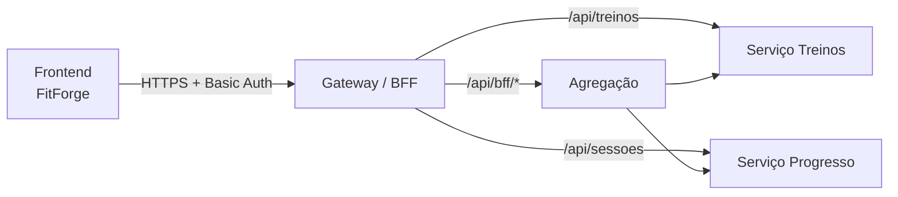

# FitForge — Gateway e BFF

Ponto de entrada HTTPS da solução FitForge. Roteia as chamadas do frontend para os microsserviços, protege o acesso com autenticação e agrega dados de vários serviços em uma única resposta (padrão **BFF**, *Backend for Frontend*).

**Integrantes:** Andryus Zolet, Nicolas Medeiros, Valentin Rojas e Leonardo Henrique. Detalhes em [GRUPO.md](GRUPO.md).

## Sumário

- [Links](#links)
- [Visão geral](#visão-geral)
- [Arquitetura](#arquitetura)
- [Rotas](#rotas)
- [Autenticação e segurança](#autenticação-e-segurança)
- [Pré-requisitos](#pré-requisitos)
- [Execução local](#execução-local)
- [Testes](#testes)
- [Variáveis de configuração](#variáveis-de-configuração)
- [Deploy na Azure](#deploy-na-azure)
- [Estrutura do repositório](#estrutura-do-repositório)
- [Documentação e entrega](#documentação-e-entrega)
- [Status e limitações](#status-e-limitações)

## Links

| Recurso | Endereço |
| --- | --- |
| Gateway (Azure) | https://fitforge-gateway-hvaqcubhf8d0a2hc.chilecentral-01.azurewebsites.net |
| Swagger / OpenAPI | https://fitforge-gateway-hvaqcubhf8d0a2hc.chilecentral-01.azurewebsites.net/swagger-ui.html |
| Frontend (Azure) | https://c4pivara35.z21.web.core.windows.net/ |
| Repositório do frontend | https://github.com/C4pivara35/FitForge |
| Repositório do backend | https://github.com/C4pivara35/FitForge-Microservicos |

## Visão geral

O Gateway reúne cinco responsabilidades:

- **Roteamento:** proxy CRUD para os serviços de Treinos e Progresso.
- **Autenticação:** HTTP Basic.
- **CORS:** libera a origem do frontend configurada em `CORS_ORIGINS`.
- **Correlação:** rastreio das requisições entre Gateway e serviços.
- **Agregação (BFF):** combina fichas, sessões, estatísticas e estado dos serviços em uma só resposta.

Stack: **Java 21**, **Maven**, **Spring Cloud Gateway** e **WebFlux**.

## Arquitetura



Decisões principais:

- **Vertical Slice Architecture**, com separação interna de responsabilidades e dependências verificadas por testes (ArchUnit).
- **O Gateway não recebe credenciais de Mongo, SQL ou broker.** Ele só conhece as URLs dos serviços.
- **Os serviços podem ser protegidos por chave interna**, o que elimina o acesso direto aos dados sem passar pelo Gateway.
- A aplicação de SOLID e os limites do desenho estão detalhados na Arc42.

## Rotas

| Rota | Responsabilidade |
| --- | --- |
| `/api/treinos/**` | Proxy CRUD para Treinos |
| `/api/sessoes/**` | Proxy CRUD para Progresso |
| `/api/bff/dashboard` | Fichas, sessões, estatísticas e estado dos serviços |
| `/api/bff/treinos/{id}` | Ficha e histórico agregado |
| `/api/bff/historico` | Histórico enriquecido com a situação da ficha |
| `/api/bff/status` | Estado das dependências |
| `/api/auth/check` | Verificação de credencial |
| `/api/auth/register` | Cadastro via Progresso, quando configurado |
| `/swagger-ui.html`, `/v3/api-docs` | Documentação OpenAPI |

## Autenticação e segurança

- O acesso usa **HTTP Basic**. Usuário e senha vêm de `FITFORGE_USERNAME` e `FITFORGE_PASSWORD`.
- O perfil `azure` **exige autenticação** e **não usa URLs localhost como fallback**.
- A **chave interna** (`FITFORGE_INTERNAL_KEY`) deve ter o **mesmo valor** no Gateway e nos dois serviços. Com ela ativada também nos serviços, o acesso direto aos dados deixa de ser possível.
- Valores reais de senha e chave ficam no portal da Azure, **nunca no Git**.

## Pré-requisitos

- JDK **21**
- Maven 3.9 ou superior
- Serviços de Treinos e Progresso rodando localmente em `8081` e `8082` (veja o [repositório do backend](https://github.com/C4pivara35/FitForge-Microservicos))

## Execução local

A porta local é **8080**.

**PowerShell**

```powershell
mvn -B clean verify
$env:FITFORGE_AUTH_REQUIRED = "true"
$env:FITFORGE_USERNAME = "fitforge"
$env:FITFORGE_PASSWORD = "senha-local-de-demonstracao"
mvn spring-boot:run
```

**Bash (Linux/macOS)**

```bash
mvn -B clean verify
export FITFORGE_AUTH_REQUIRED="true"
export FITFORGE_USERNAME="fitforge"
export FITFORGE_PASSWORD="senha-local-de-demonstracao"
mvn spring-boot:run
```

A senha acima é apenas um exemplo para o modo local.

Para testar **cadastro** ou a **segurança interna** localmente, defina o mesmo `FITFORGE_INTERNAL_KEY` no Gateway e nos dois serviços.

O repositório também traz os scripts `start-gateway.bat` (Windows) e `start-gateway.sh` (Linux/macOS) como atalho de inicialização.

Depois de iniciar, acesse `http://localhost:8080/swagger-ui.html` para explorar a API.

## Testes

```bash
mvn -B clean verify
```

A suíte cobre:

- **Unidade:** lógica de agregação do BFF.
- **Segurança:** autenticação e regras de acesso.
- **Integração HTTP:** rotas e proxy.
- **Arquitetura (ArchUnit):** limites entre camadas e dependências.

## Variáveis de configuração

| Variável | Uso |
| --- | --- |
| `SPRING_PROFILES_ACTIVE` | Use `azure` em produção. |
| `TREINOS_SERVICE_URL` | URL do serviço de Treinos. |
| `PROGRESSO_SERVICE_URL` | URL do serviço de Progresso. |
| `CORS_ORIGINS` | Origem permitida do frontend, por exemplo `https://c4pivara35.z21.web.core.windows.net`. |
| `FITFORGE_AUTH_REQUIRED` | Quando `true`, exige autenticação (uso local; o perfil Azure já exige). |
| `FITFORGE_USERNAME` | Usuário do HTTP Basic. |
| `FITFORGE_PASSWORD` | Senha do HTTP Basic. |
| `FITFORGE_INTERNAL_KEY` | Segredo compartilhado com os dois serviços. |

## Deploy na Azure

**1. Configure o App Service.** Preencha `TREINOS_SERVICE_URL`, `PROGRESSO_SERVICE_URL`, `CORS_ORIGINS`, `FITFORGE_USERNAME`, `FITFORGE_PASSWORD` e `FITFORGE_INTERNAL_KEY`. Depois ative `SPRING_PROFILES_ACTIVE=azure`.

**2. Configure o GitHub Actions.** O workflow usa:

| Tipo | Nome |
| --- | --- |
| Variável | `AZURE_WEBAPP_GATEWAY` |
| Segredo | `AZUREAPPSERVICE_PUBLISHPROFILE` |

**3. Publique.** O workflow testa o projeto e publica `target/app.jar`. Mudanças apenas em README, GRUPO ou `docs/` **não** disparam o deploy.

O filtro de deduplicação garante uma única origem CORS na resposta.

Para Azure SQL, Service Bus e o backend, consulte o [guia de deploy](https://github.com/C4pivara35/FitForge-Microservicos/blob/main/docs/DEPLOY-AZURE.md).

## Estrutura do repositório

```text
FitForge-API_Gateway/
├── src/                              # código-fonte e testes
├── .github/workflows/                # pipeline de build, teste e deploy
├── docs/                             # Arc42 e checklist de validação
├── pom.xml                           # build Maven
├── start-gateway.bat                 # atalho de execução (Windows)
├── start-gateway.sh                  # atalho de execução (Linux/macOS)
├── ARC42-FitForge-API_Gateway.docx   # versão Word da Arc42
└── GRUPO.md                          # integrantes do grupo
```

## Documentação e entrega

- [Arc42 completa (12 seções)](docs/ARC42.md)
- [Checklist de validação e evidências](docs/VALIDACAO-ENTREGA.md)
- [Guia de Azure SQL, Service Bus e publicação](https://github.com/C4pivara35/FitForge-Microservicos/blob/main/docs/DEPLOY-AZURE.md)
- [Integrantes do grupo](GRUPO.md)

## Status e limitações

- Código e CI aprovados **não** comprovam a ativação de SQL e mensageria; essa conclusão depende da configuração e das evidências na Azure.
- **Vídeo de apresentação:** pendente de gravação e publicação como não listado no YouTube. Inserir o link aqui após validar o fluxo em nuvem, com todos os integrantes falando e com a câmera aberta.
