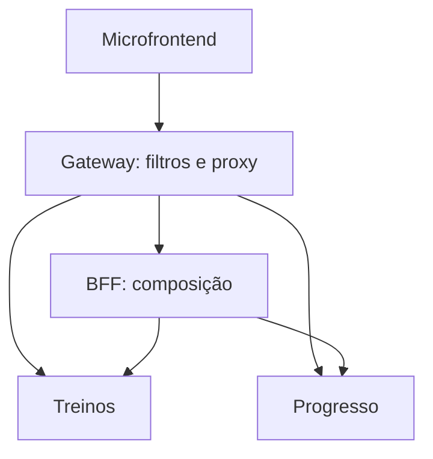

# Arc42 — FitForge Gateway e BFF

Versão: 1.0 — 17/11/2026. Equipe: Andryus Zolet, Nicolas Medeiros, Valentin Rojas e Leonardo Henrique.

Esta documentação descreve decisões e código existentes, além da configuração prevista na Azure. A validação operacional exige o [checklist de entrega](VALIDACAO-ENTREGA.md); documentar uma integração não comprova sua ativação.

## 1. Introdução e objetivos

O Gateway oferece uma entrada HTTPS para o frontend e encaminha o CRUD aos domínios de Treinos e Progresso. O BFF combina fichas, sessões e estatísticas para as telas. O componente não é proprietário de bancos de negócio e não faz consultas SQL ou MongoDB diretamente.

| Interessado | Objetivo |
|---|---|
| Usuário do FitForge | Acessar uma API coerente e receber dados do painel |
| Frontend | Usar uma URL pública e contratos adequados às telas |
| Microsserviços | Receber requisições encaminhadas com contexto de segurança |
| Equipe/avaliador | Ver roteamento, autenticação, agregação, Swagger e rastreamento |

Prioridades: segurança de entrada, centralização, composição correta e diagnóstico de falhas. Administração de bancos, processamento de eventos e prescrição de exercícios não são responsabilidades deste repositório.

## 2. Restrições

Java 21, Spring Boot 3.3.4, Spring Cloud Gateway/WebFlux, Maven e Swagger/OpenAPI. A aplicação é publicada como JAR em um App Service Linux. Os serviços e o frontend ficam em repositórios distintos. Os planos gratuitos possuem cotas, cold start e ausência de garantia de disponibilidade.

A autenticação implementada é HTTP Basic sobre HTTPS para demonstração e contas do projeto. Não se afirma uso de OAuth, JWT ou Azure API Management. Credenciais, chave interna e URLs ficam em variáveis externas. O Gateway não utiliza `DB_URL`, `MONGODB_URI` nem conexão com o Service Bus.

## 3. Contexto e escopo

| Fronteira | Protocolo/contrato | Contexto enviado |
|---|---|---|
| Front → Gateway | HTTPS, JSON, `/api/**` | Authorization e origem CORS |
| Gateway → Treinos | HTTPS, `/api/treinos/**` | Chave interna, proprietário e correlação |
| Gateway → Progresso | HTTPS, `/api/sessoes/**` | Chave interna, proprietário e correlação |
| Gateway → contas de Progresso | `/api/internal/accounts...` | Chave interna e credenciais para validação |
| Avaliador → Swagger | `/swagger-ui.html`, `/v3/api-docs` | Documentação dos contratos |

Os bancos e o broker pertencem aos microsserviços. O frontend não deve usar seus endereços diretamente. A chave interna nos serviços deve estar ativa para impedir que um cliente contorne a autenticação do Gateway.

## 4. Estratégia da solução

O padrão adotado é **Vertical Slice Architecture**: a funcionalidade BFF reúne controlador, contratos, serviço de composição e clientes HTTP. Segurança, configuração e filtros são preocupações transversais. Dentro da fatia há separação entre entrada HTTP, composição e comunicação externa.

Spring Cloud Gateway encaminha o CRUD sem reimplementar os casos de uso dos serviços. O BFF usa `WebClient` e Reactor para consultar fontes independentes em paralelo e formar um único JSON. Falhas de dependência são representadas por estados/fallbacks documentados, preservando a possibilidade de a tela informar resultados parciais.

## 5. Visão de blocos

| Bloco | Elementos | Responsabilidade |
|---|---|---|
| Entrada do BFF | `bff/controller/BffController` | Contrato HTTP e contexto da requisição |
| Composição | `bff/service/BffService` | Dashboard, ficha detalhada e histórico enriquecido |
| Contratos | `bff/dto/*` | Estrutura da resposta e dados recebidos |
| Clientes | `bff/client/WebClientConfig` | Clientes por serviço e cabeçalhos internos |
| Segurança | `security/GatewaySecurity`, `AccountScope`, `AccountGateway` | Autenticar, identificar conta e consultar contas |
| Filtros | `InternalRoutingFilter`, `CorrelationIdFilter`, `GlobalLoggingFilter` | Contexto seguro, correlação e logs |
| Rotas | `src/main/resources/application.yml` | Proxy, timeout, retry GET e deduplicação CORS |
| OpenAPI | `config/GatewayOpenApi` | Contratos de proxy e BFF no Swagger |

O BFF não depende de repositories JPA/MongoDB. O controller do BFF não depende de `WebClient`. Essa fronteira é verificada pelo ArchUnit.

## 6. Visão de execução

### 6.1 Autenticação e proxy CRUD

O cliente chama `/api/auth/check` com Basic. A conta de demonstração é comparada com as configurações do Gateway; outras contas podem ser autenticadas pelo serviço de contas de Progresso, com a chave interna configurada. Sem credenciais válidas, a rota protegida retorna `401`.

Em uma chamada CRUD autenticada, o Gateway remove cabeçalhos de contexto que poderiam ser forjados, define proprietário a partir do usuário autenticado e encaminha a chave interna. O serviço valida a chave e aplica as regras do seu domínio. A resposta HTTP retorna ao navegador. Retry automático está restrito a GET e falhas transitórias configuradas; POST não é repetido automaticamente pelo Gateway.

### 6.2 Agregação do painel

`GET /api/bff/dashboard` consulta fichas em Treinos, sessões em Progresso e estatísticas em Progresso. `Mono.zip` combina os resultados. O BFF calcula resumos por ficha e enriquece as sessões com a situação atual da ficha, retornando também `statusMicrosservicos` e `geradoEm`.

### 6.3 Indisponibilidade parcial

Se a leitura de uma dependência falha, os helpers do BFF registram a falha e aplicam a política de fallback. Uma resposta de dashboard pode ser `200` e incluir um serviço `OFFLINE`; portanto, apenas o status HTTP não comprova a integridade da composição. A tela deve inspecionar os estados recebidos.

### 6.4 Cadastro

`POST /api/auth/register` encaminha a criação ao domínio de contas de Progresso. Sem autenticação habilitada e chave interna, o cadastro responde como indisponível. O Gateway não armazena senhas de usuários em banco próprio. O serviço de contas mantém hashes BCrypt no SQL.

## 7. Visão de implantação

Aplicação: [Gateway FitForge](https://fitforge-gateway-hvaqcubhf8d0a2hc.chilecentral-01.azurewebsites.net).

| Variável no App Service | Finalidade |
|---|---|
| `SPRING_PROFILES_ACTIVE=azure` | Exigir configuração de nuvem |
| `TREINOS_SERVICE_URL` | URL HTTPS do serviço de Treinos |
| `PROGRESSO_SERVICE_URL` | URL HTTPS de Progresso |
| `CORS_ORIGINS` | Origem exata `https://c4pivara35.z21.web.core.windows.net` |
| `FITFORGE_USERNAME`, `FITFORGE_PASSWORD` | Conta de demonstração |
| `FITFORGE_INTERNAL_KEY` | Mesmo segredo nos três aplicativos |

`application-azure.yml` exige autenticação e valores de nuvem. GitHub Actions compila, testa e publica `target/app.jar` usando `AZURE_WEBAPP_GATEWAY` e `AZUREAPPSERVICE_PUBLISHPROFILE`. As credenciais da aplicação não são as credenciais do publish profile.

O perfil é ativado no App Service, não no workflow Maven. Testes CI usam configurações de teste. Mudanças apenas em README, integrantes e `docs/` não disparam deploy pelo workflow atualizado. Não há banco nem volume de negócio a migrar neste aplicativo.

## 8. Conceitos transversais

### SOLID e dependências

| Princípio | Evidência |
|---|---|
| SRP | Controllers expõem HTTP; BffService compõe; filtros tratam preocupações de entrada |
| OCP | Rotas de proxy são declarativas; novos caminhos podem ser acrescentados sem alterar o CRUD dos serviços |
| LSP | Clientes usados em testes preservam respostas e erros esperados pelo contrato HTTP |
| ISP | DTOs representam dados necessários ao BFF, sem importar entidades JPA/Mongo |
| DIP | Dependências e Clock entram por construtor; o BFF não conhece implementações de persistência |

DIP é aplicado na separação de responsabilidades e substituição de colaboradores. O BFF depende de `WebClient`, um detalhe do framework; o projeto não pretende demonstrar independência total de frameworks de uma arquitetura Clean.

### Segurança e CORS

O Gateway aceita a origem configurada e os cabeçalhos de autenticação necessários. OPTIONS pode passar para viabilizar preflight. A deduplicação de `Access-Control-Allow-Origin` evita que Gateway e serviço gerem dois valores incompatíveis. CORS é controle do navegador e não substitui autenticação.

`InternalRoutingFilter` remove Authorization da requisição encaminhada e configura contexto interno. A conta de demonstração usa o escopo legado; contas cadastradas usam seu identificador. A chave interna precisa estar configurada também nos serviços. Swagger e health são acessíveis para demonstração, enquanto o CRUD é protegido.

### Observabilidade e resiliência

Cabeçalhos `X-Correlation-Id`, `X-Gateway-Route` e identificação do Gateway auxiliam a demonstração. Logs não devem registrar senhas nem Authorization. Proxy usa connect timeout de 5 segundos e response timeout de 20 segundos; o BFF tem timeout configurável, padrão 15 segundos. Essas políticas não garantem atendimento durante cota excedida.

### Testes

Há testes unitários isolados de composição, testes de segurança, integração HTTP e regras ArchUnit. A regra de arquitetura bloqueia acesso direto do controller a persistência, WebClient e SDK de broker. O projeto não inclui teste end-to-end de uma assinatura Azure real no CI.

## 9. Decisões arquiteturais

| ADR | Decisão | Motivo e consequência |
|---|---|---|
| GW-01 | Gateway e BFF no mesmo processo | Simplifica a entrega; combina seus ciclos de publicação |
| GW-02 | Separar proxy de composição | CRUD preserva contratos dos serviços; telas recebem agregação própria |
| GW-03 | WebFlux/WebClient | Consultas paralelas com timeout; exige tratamento reativo de contexto e erro |
| GW-04 | Basic sobre HTTPS e chave interna | Atende à autenticação demonstrável; não substitui solução corporativa OIDC |
| GW-05 | Retry apenas em GET | Evita duplicar escritas por repetição automática |
| GW-06 | Estado de dependências no JSON | Permite degradação explícita; `200` isolado deixa de ser prova suficiente |

## 10. Requisitos de qualidade

Critérios de aceitação planejados:

| Cenário | Estímulo | Resposta verificável |
|---|---|---|
| QG-01 Segurança | GET de CRUD sem credencial | `401` no Gateway |
| QG-02 Fronteira interna | GET direto em serviço sem chave após configuração | `403` no serviço |
| QG-03 Agregação | Dashboard com serviços disponíveis | Um JSON com fichas, sessões e ambos `ONLINE` |
| QG-04 CORS | Origem autorizada envia preflight | Resposta permite origem e Authorization, sem duplicação |
| QG-05 Resiliência | Serviço indisponível | Falha limitada por timeout e estado parcial explícito |
| QG-06 Manutenibilidade | Controller passa a acessar WebClient diretamente | ArchUnit falha no CI |
| QG-07 Rastreamento | CRUD encaminhado | Resposta identifica rota e correlação |

Árvore de qualidade: segurança → autenticação/fronteira interna; confiabilidade → timeout/retry de leitura; modificabilidade → BFF separado do proxy; testabilidade → colaboradores injetados.

## 11. Riscos e dívida técnica

| Risco | Tratamento/limitação |
|---|---|
| Chave interna ausente | Preencher o mesmo segredo nos três apps e testar acesso direto rejeitado |
| Progresso ainda em H2 | Conectar Azure SQL; Gateway sozinho não comprova banco utilizado |
| Broker desativado | Configurar e validar no backend, fora da responsabilidade do Gateway |
| Cotas F1 e cold start | Conferir cotas e aquecer o fluxo antes da gravação, sem promessa de disponibilidade |
| Listagens completas no BFF | Adicionar paginação/caching no futuro para conjuntos maiores |
| Conta compartilhada de demonstração | Evoluir identidade e autorização por papéis conforme necessidade |
| Falha de estatísticas parcialmente degradada | Conferir estado e formato do painel, incluindo buckets semanais |

Na auditoria anterior a este pacote, a chave interna não estava configurada. Os arquivos fornecem os requisitos para a configuração, mas a evidência final depende do checklist. O vídeo não é produzido por este repositório.

## 12. Glossário

| Termo | Definição |
|---|---|
| Proxy | Encaminhamento da operação para o serviço responsável |
| BFF | Composição específica para a interface |
| Correlação | Identificador que acompanha uma requisição |
| Preflight | OPTIONS enviado pelo navegador antes de certas chamadas CORS |
| Proprietário | Identidade usada para isolar registros de contas |
| Chave interna | Segredo para autenticar chamadas do Gateway aos serviços |
| Fallback | Resposta alternativa explícita após falha de dependência |
| Vertical Slice | Organização por funcionalidade com camadas internas |

Referência: [estrutura arc42](https://arc42.org/overview/). Este texto descreve o FitForge e não reproduz o conteúdo do template.
